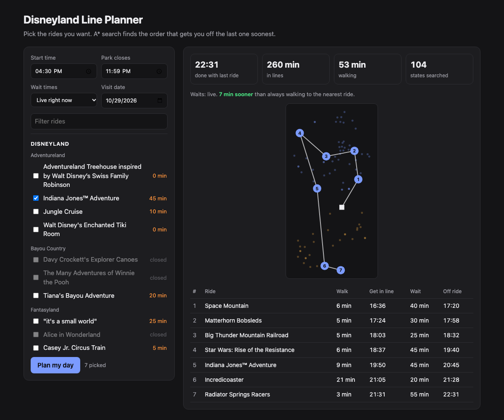

# Disneyland Line Planner

Pick the Disneyland Resort rides you want to do. The planner predicts how long each line will be through the day and uses **A\* search** to find the order that gets you off your last ride soonest, counting walking time between rides and the walk between the two parks.

Python · FastAPI · pandas · scikit-learn · GitHub Actions



## How it works

```
Queue-Times.com ──(every 10 min, GitHub Actions)──> data/raw/YYYY-MM-DD.csv
                                                         │
OpenStreetMap ride locations ──> data/rides.csv          ▼
          │                                   dlp/model.py  gradient boosting
          ▼                                         │  (ride, weekday, time, holiday)
dlp/park.py  walking times                          ▼
          └──────────────> dlp/search.py  A* over (where I am, rides left, clock time)
                                   │
                           app/  FastAPI + one plain HTML page
```

### 1. Data collector
[`collector/collect.py`](collector/collect.py) pulls the live wait for every ride in Disneyland (park 16) and Disney California Adventure (park 17) and appends one row per ride to a daily CSV: UTC timestamp, park, ride id, ride name, land, open/closed, posted wait. A [GitHub Actions cron](.github/workflows/collect.yml) runs it every 10 minutes and commits the new rows, so the dataset grows on its own. It uses only the Python standard library.

### 2. Route search (A\*)
**State:** current location, set of rides left (a bitmask), clock time.
**Action:** walk to one of the rides left, join its line, ride it.
**Cost:** minutes from the start until the last ride ends.

Two details make the search exact rather than a heuristic guess:

- **Rest before a long line.** Waits change through the day, so arriving earlier can mean boarding later (a 90-minute line at 9:45 that drops to 5 minutes at 10:00). The planner may rest and join the line later. With that option, arriving earlier is never worse ("first in, first out" travel times), so for each *(location, rides left)* only the earliest arrival needs to be kept.
- **Admissible heuristic.** Every ride still left costs at least *ride length + its smallest wait from now on + the shortest walk into it* from any place it could be reached from (where I am now, or another ride still left). Each ride is entered exactly once, so this sum never overestimates the time left, and A\* returns the optimal order.

Tests check A\* against brute force over all orders on 25 random cases with time-varying waits ([`tests/test_search.py`](tests/test_search.py)).

Walking time = straight-line distance × 1.35 (paths aren't straight) at 70 m/min. Going between parks goes through both gates, plus 5 minutes.

### 3. Wait-time model
[`dlp/model.py`](dlp/model.py) builds features with pandas (ride, day of week, minute of day, weekend, US/California holiday, within 2 days of a holiday, month) and trains a scikit-learn `HistGradientBoostingRegressor` (absolute-error loss, ride id as a categorical feature). It holds out the most recent 7 days and compares against two baselines:

- **Same time last week:** the posted wait for that ride 7 days earlier, at the nearest 10 minutes.
- **Ride × hour average** from the training days.

The planner uses the model's predictions in 15-minute slots for a future visit date. A ride is treated as closed in slots where it was usually closed in the history.

### 4. Web app
`app/` is a FastAPI server with one plain HTML/JS page: pick rides (live waits shown next to each), a start time and live or predicted waits; get a route map, a timeline, and how much sooner it is than always walking to the nearest ride.

## Results

**Search** — 40 random sets of 8 rides, real waits from one snapshot (Oct 29, 2026, 4:05 pm) held constant, start 9:00 ([`scripts/benchmark.py`](scripts/benchmark.py)):

| order | total time (min) | walking (min) |
|---|---|---|
| A\* (optimal) | 305 | 52 |
| greedy: nearest ride next | 307 | 55 |
| greedy: shortest line next | 364 | 111 |

A\* expanded 183 states on average vs 1,017 for uniform-cost search (5.6× fewer) and found the same optimal times. With waits held constant, only walking order matters, so "nearest ride next" is already close to optimal; chasing the shortest line costs about an hour of extra walking. The gap should grow with predicted waits, where timing (e.g. riding a headliner before the afternoon peak) matters.

**Model** — retrained every Monday by a [GitHub Action](.github/workflows/retrain.yml), which rewrites this section from [`results/metrics.json`](results/).

<!-- model-results:start -->
Data collection started Oct 29, 2026. The first results appear after two weeks of data, when the "same time last week" baseline can be measured.
<!-- model-results:end -->

## Run it

```bash
python -m venv .venv && source .venv/bin/activate
pip install -r requirements-dev.txt

pytest                                   # tests
python -m dlp.cli --rides "space mountain, matterhorn, rise of the resistance, radiator springs" --start 09:00 --compare
python -m dlp.model                      # train + evaluate (needs collected data)
uvicorn app.main:app --reload            # http://127.0.0.1:8000
```

Other scripts: `python scripts/build_rides.py` rebuilds `data/rides.csv` from the OSM snapshot and collected ride names; `python scripts/benchmark.py` reproduces the table above.

## Limits

- Posted waits are Disney's estimates, not measured times.
- Ride lengths are approximate; walking uses straight-line distance with a detour factor, not real paths.
- Lightning Lane, single rider lines, shows with fixed times and breakdowns are not modeled.

## Data and credits

- Wait times: **Powered by [Queue-Times.com](https://queue-times.com/)**.
- Ride locations: © [OpenStreetMap](https://www.openstreetmap.org/copyright) contributors, available under the Open Database License (ODbL). Snapshot in `data/osm/`.
- Not affiliated with or endorsed by Disney.

MIT License.
